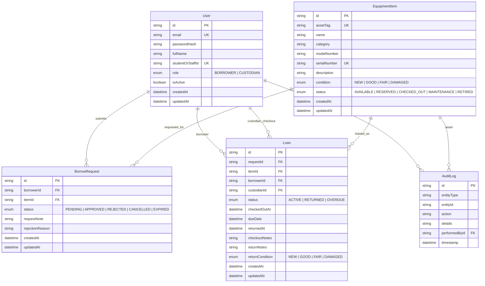

# System-Level Software Design Specification (SDS)

## CPE Equipment & Hardware Inventory and Borrowing System (EquipFlow)

**Document ID:** `SDS-SYS-01`  
**Version:** `1.0.0`  
**Status:** Wait for review
**Deliverable:** Project Deliverable 1 — Part C  

---

## 1. System Architecture & Tech Stack

### 1.1 Architectural Overview

EquipFlow is structured as a **modular full-stack application** composed of three logical tiers:

1. **Client Tier (Presentation):** Single Page Application (SPA) built with React 18, Vite, and TypeScript.
2. **Application / API Tier (Business Logic):** RESTful service built with Node.js, Express, and TypeScript, structured into Controllers, Services, and Domain Validators.
3. **Persistence Tier (Data):** Relational database managed through Prisma ORM (SQLite for local deterministic development and testing; PostgreSQL in a Docker container for production / GCP deployment).

```mermaid
graph TD
    subgraph Client Tier ["Client Tier (Browser)"]
        UI[React 18 + Vite SPA]
        Router[React Router DOM]
        State[Auth & UI Context Store]
    end

    subgraph API Tier ["Application / API Tier (Express + TS)"]
        AuthMW[Auth Middleware (JWT)]
        RoleMW[Role Guard Middleware]
        Controllers[API Route Controllers]
        Services[Domain Service Layer]
        Validators[Zod / Schema Validation]
    end

    subgraph Data Tier ["Persistence Tier (Prisma ORM)"]
        Prisma[Prisma Client]
        DB[(SQLite / PostgreSQL)]
    end

    UI -->|HTTP / JSON REST API| AuthMW
    AuthMW --> RoleMW
    RoleMW --> Controllers
    Controllers --> Validators
    Validators --> Services
    Services -->|Business Rules Enforced Here| Prisma
    Prisma --> DB
```

### 1.2 Technology Stack Rationale

| Layer | Selected Technology | Version | Rationale & Justification |
| :--- | :--- | :--- | :--- |
| **Frontend Framework** | **React** with **Vite** | `18.3.x` / `6.x` | High responsiveness, fast HMR during development, strong component reusability, and continuity with TokTickIT labs 1–4. |
| **Language** | **TypeScript** | `5.7.x` | End-to-end type safety between client API calls, backend routes, and database models, eliminating common runtime type errors. |
| **Styling & UI** | **Bootstrap 5** | `5.3.x` | Clean, standardized utility classes, responsive grid system (mobile/tablet/desktop), and zero styling overhead. |
| **Backend Runtime** | **Node.js + Express** | `22.x` / `4.21.x` | Lightweight, fast event-driven HTTP request handling with robust middleware support for auth and role checks. |
| **ORM / Data Access** | **Prisma ORM** | `5.22.x` | Type-safe queries, automated database migrations, declarative schema definition, and seamless seed scripting. |
| **Database Engine** | **SQLite (Dev/Test)**<br>**PostgreSQL (Prod)** | SQLite 3<br>PG 16 | SQLite enables zero-friction, isolated, file-based automated tests without external database containers. PostgreSQL ensures cloud durability for GCP Cloud Run (Lab 5). |
| **Testing Tools** | **Vitest**, **Supertest**, **Playwright** | Vitest 2.x<br>Supertest 7.x<br>Playwright 1.63.x | Vitest for lightning-fast unit and domain rule testing; Supertest for API and auth integration; Playwright for browser E2E journeys. |

### 1.3 Communication & Business Rule Enforcement Boundary

* **Strict Backend Enforcement:** All domain invariants and business rules (`BR-01` to `BR-08`) are enforced exclusively within the **Backend Service Layer** (`src/services/`).
* The client UI disables buttons and provides client-side validation solely for user convenience. A hidden button or disabled input is never treated as authorization.
* Every mutating request executes inside a database transaction (`prisma.$transaction`) to guarantee atomicity and prevent race conditions.

---

## 2. Domain Data Model & Entity Specifications

### 2.1 Entity Relationship Diagram (ERD)



### 2.2 Entity Field Dictionary & Integrity Constraints

#### 1. `User` Entity

* `id` (String, UUID/CUID, Primary Key)
* `email` (String, Unique, Not Null) — Institutional email address used for login.
* `passwordHash` (String, Not Null) — bcrypt hash (salt rounds $\ge 10$). Plaintext never stored.
* `fullName` (String, Not Null) — User display name.
* `studentOrStaffId` (String, Unique, Not Null) — Academic identifier (e.g., student ID `67070501026`).
* `role` (Enum: `BORROWER`, `CUSTODIAN`, Not Null) — User role for access control.
* `isActive` (Boolean, Default `true`) — Disabled users cannot log in.

#### 2. `EquipmentItem` Entity

* `id` (String, UUID/CUID, Primary Key)
* `assetTag` (String, Unique, Not Null) — Scannable department inventory barcode/tag (e.g., `CPE-OSC-001`).
* `name` (String, Not Null) — Equipment title (e.g., "Rigol DS1054Z Digital Oscilloscope").
* `category` (String, Not Null) — Classification (e.g., "Measurement", "Microcontrollers", "FPGA").
* `modelNumber` (String, Nullable) — Manufacturer part number.
* `serialNumber` (String, Unique, Not Null) — Manufacturer hardware serial number.
* `condition` (Enum: `NEW`, `GOOD`, `FAIR`, `DAMAGED`, Default `GOOD`).
* `status` (Enum: `AVAILABLE`, `RESERVED`, `CHECKED_OUT`, `MAINTENANCE`, `RETIRED`, Default `AVAILABLE`).

#### 3. `BorrowRequest` Entity

* `id` (String, UUID/CUID, Primary Key)
* `borrowerId` (String, Foreign Key $\rightarrow$ `User.id`, Not Null)
* `itemId` (String, Foreign Key $\rightarrow$ `EquipmentItem.id`, Not Null)
* `status` (Enum: `PENDING`, `APPROVED`, `REJECTED`, `CANCELLED`, `EXPIRED`, Default `PENDING`).
* `requestNote` (String, Nullable) — Stated academic purpose of request.
* `rejectionReason` (String, Nullable) — Recorded when rejected by custodian.

#### 4. `Loan` Entity

* `id` (String, UUID/CUID, Primary Key)
* `requestId` (String, Foreign Key $\rightarrow$ `BorrowRequest.id`, Unique, Nullable)
* `itemId` (String, Foreign Key $\rightarrow$ `EquipmentItem.id`, Not Null)
* `borrowerId` (String, Foreign Key $\rightarrow$ `User.id`, Not Null)
* `custodianId` (String, Foreign Key $\rightarrow$ `User.id`, Not Null) — Accountable staff recording checkout.
* `status` (Enum: `ACTIVE`, `RETURNED`, `OVERDUE`, Default `ACTIVE`).
* `checkedOutAt` (DateTime, Default `now()`).
* `dueDate` (DateTime, Not Null) — Authoritative deadline (`checkedOutAt + 7 days`).
* `returnedAt` (DateTime, Nullable).
* `returnCondition` (Enum, Nullable).

---

## 3. UI, API & Access Conventions

### 3.1 Screen Hierarchy & Navigation

The UI provides distinct views based on authenticated role identity:

```
[ Public / Unauthenticated ]
    ├── Login View (/login)
    
[ Authenticated: Borrower ]
    ├── Catalog Browser View (/catalog)
    │     └── Item Detail Modal (Specs, Status, "Request Item" button)
    └── My Requests & Loans View (/my-loans)
          ├── Active Loans List (Item details, Checked out date, Due date)
          └── Pending Requests List (Status badges: PENDING, APPROVED)

[ Authenticated: Custodian ]
    ├── Custodian Operations Desk (/custodian/desk)
    │     ├── Pending Requests Queue ("Approve & Checkout", "Reject" actions)
    │     └── Active Loans Queue ("Process Return" action)
    ├── Inventory Catalog Manager (/custodian/inventory)
    └── System Audit Logs View (/custodian/logs) [Sprint 3]
```

### 3.2 Shared UI Behaviors

* **Loading States:** All asynchronous fetch actions render a standardized loading spinner or skeleton card.
* **Empty States:** When a list is empty (e.g., zero pending requests), a contextual empty state card is rendered (`"No pending requests found."`).
* **Validation Feedback:** Forms display red inline helper text upon field validation failure and disable submit buttons while the request is in flight to prevent double submissions.
* **Alerts & Toasts:** Action confirmations (e.g., `"Checkout recorded successfully"`) appear as floating dismissible alerts.

### 3.3 API Conventions & Error Structure

All API endpoints follow RESTful URI conventions under `/api/v1/` and return a standard JSON envelope:

#### Successful Response Format

```json
{
  "success": true,
  "data": { ... },
  "meta": {
    "timestamp": "2026-11-12T18:00:00.000Z"
  }
}
```

#### Error Response Format

```json
{
  "success": false,
  "error": {
    "code": "ITEM_UNAVAILABLE",
    "message": "Equipment item CPE-OSC-001 is already checked out.",
    "details": null
  },
  "meta": {
    "timestamp": "2026-11-12T18:00:00.000Z"
  }
}
```

#### HTTP Status Codes

* `200 OK`: Request succeeded.
* `201 Created`: Resource successfully created.
* `400 Bad Request`: Validation failure or business rule violation (`BR-01`, `BR-04`).
* `401 Unauthorized`: Missing or invalid authentication token.
* `403 Forbidden`: Authenticated user lacks required role or is attempting cross-user access (`BR-03`, `FR-11`).
* `404 Not Found`: Target resource does not exist.
* `409 Conflict`: Concurrency conflict (e.g., item already locked by competing request `BR-02`).
* `500 Internal Server Error`: Unhandled server exception (sanitized in production).

### 3.4 Role & Permission Matrix

| Operation / Endpoint | Anonymous | Borrower | Custodian | Ownership Constraint |
| :--- | :---: | :---: | :---: | :--- |
| `POST /api/auth/login` | **Allowed** | Allowed | Allowed | Public |
| `POST /api/auth/logout` | Denied (401) | **Allowed** | **Allowed** | Authenticated session |
| `GET /api/auth/me` | Denied (401) | **Allowed** | **Allowed** | Authenticated session |
| `GET /api/items` | Denied (401) | **Allowed** | **Allowed** | All items |
| `GET /api/items/:id` | Denied (401) | **Allowed** | **Allowed** | Single item details |
| `POST /api/requests` | Denied (401) | **Allowed** | Denied (403) | Current user is requester |
| `GET /api/requests/my` | Denied (401) | **Allowed** | Denied (403) | Returns only owned records |
| `GET /api/custodian/requests` | Denied (401) | Denied (403) | **Allowed** | All department requests |
| `POST /api/custodian/checkouts` | Denied (401) | Denied (403) | **Allowed** | Custodian executes |
| `POST /api/custodian/returns` | Denied (401) | Denied (403) | **Allowed** | Custodian executes |
| `POST /api/custodian/items` | Denied (401) | Denied (403) | **Allowed** | Custodian executes |

### 3.5 Authentication & Session Lifecycle

* **Password Hashing:** Passwords hashed with `bcryptjs` using 10 salt rounds prior to persistence.
* **Token Issuance:** Successful authentication creates a signed JWT containing payload `{ userId: string, role: string, email: string }` signed with `JWT_SECRET` and expiring in 24 hours.
* **Token Transport:** Sent as HTTP Bearer Token in `Authorization: Bearer <token>` header or HTTP-only cookie.
* **Current User Retrieval:** Frontend calls `GET /api/auth/me` on initial boot to restore session state.
* **Logout:** Client clears stored token and calls `POST /api/auth/logout`.

---

## 4. Configuration, Seed Data & Deployment Plan

### 4.1 Environment Configuration & Secret Handling

Configuration is managed via external environment variables. No secrets are stored in version control:

* `.env.example` committed to Git containing template variable names.
* `.env` explicitly ignored in `.gitignore`.

Key variables:

```bash
NODE_ENV=development
PORT=5000
DATABASE_URL="file:./dev.db" # Local SQLite
JWT_SECRET=super-secret-cpe334-token-key-change-in-prod
JWT_EXPIRES_IN=24h
CLIENT_URL=http://localhost:5173
```

### 4.2 Reproducible Demo Seed Data

The system includes an idempotent database seed script (`npm run seed`) creating deterministic test data:

* **Borrower Account:** `borrower@cpe.kmutt.ac.th` / `Password123!` (Role: `BORROWER`)
* **Borrower Account 2:** `borrower2@cpe.kmutt.ac.th` / `Password123!` (Role: `BORROWER` for cross-access testing)
* **Custodian Account:** `custodian@cpe.kmutt.ac.th` / `Password123!` (Role: `CUSTODIAN`)
* **Seeded Assets:**
  * `CPE-OSC-001`: Rigol DS1054Z Digital Oscilloscope (`AVAILABLE`)
  * `CPE-OSC-002`: Keysight InfiniiVision Oscilloscope (`AVAILABLE`)
  * `CPE-RPI-001`: Raspberry Pi 4 Model B (4GB) (`AVAILABLE`)
  * `CPE-RPI-002`: Raspberry Pi 4 Model B (8GB) (`CHECKED_OUT` on seeded loan)
  * `CPE-FPG-001`: Terasic DE10-Lite FPGA Board (`AVAILABLE`)
  * `CPE-LOG-001`: Saleae Logic 8 USB Logic Analyzer (`MAINTENANCE`)

### 4.3 Containerization & GCP Deployment Readiness (Lab 5 Alignment)

While cloud deployment is scheduled for Lab 5, the application is architected for immediate containerization:

* Server is completely **stateless** (sessions stored in JWTs, no local in-memory session arrays).
* Multi-stage Dockerfile can bundle the Vite build into Express static hosting or an Nginx container.
* Database connection string is purely externalized, allowing instant switch from SQLite to GCP Cloud SQL (PostgreSQL) in Lab 5 without modifying application code.
